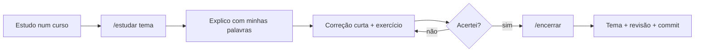

<picture>
  <source media="(prefers-color-scheme: dark)" srcset="assets/logo-dark.svg">
  
</picture>

**Tutor IA** é um tutor de estudos sob demanda, feito com o Claude Code. Não tem plano fixo: eu estudo por cursos e documentação e trago para cá o que quero praticar e fixar.

## Como funciona

O tutor não dá aula para ler. Ele me cobra: pergunta o que eu entendi, corrige curto, passa exercício e traz de volta o que eu errei para revisar depois.



O arquivo [CLAUDE.md](CLAUDE.md) define como o tutor trabalha, e o Claude Code o lê sozinho ao abrir a pasta.

### Comandos

| Comando | O que faz |
| --- | --- |
| `/estudar [tema]` | Começa uma sessão com o que eu trouxer |
| `/me-testa [tema]` | Quiz curto sobre um tema já estudado |
| `/revisao` | Revisa o que errei, com revisão espaçada (1, 7 e 30 dias) |
| `/onde-paramos` | Resumo do que já estudei e do que tenho para revisar |
| `/encerrar` | Registra a sessão, atualiza o tema e as revisões e faz o commit |

## Estrutura

```text
tutor-ia/
├── CLAUDE.md          instruções do tutor (lidas pelo Claude Code)
├── duvidas.md         dúvidas abertas e itens para revisar
├── temas/             um arquivo por assunto estudado
├── sessoes/           uma nota por sessão (AAAA-MM-DD.md)
├── templates/         modelos de tema e de sessão
├── conteudo/          LinkedIn e Substack: guia, pautas, métricas, posts
└── .claude/skills/    comandos /estudar /me-testa /revisao /onde-paramos /encerrar
```

## Quer usar?

Exige o Claude Code (plano pago do Claude).

```bash
git clone https://github.com/mauriciofeoli/tutor-ia.git
cd tutor-ia
claude
```

Depois é só `/estudar` e contar o que você estudou.
